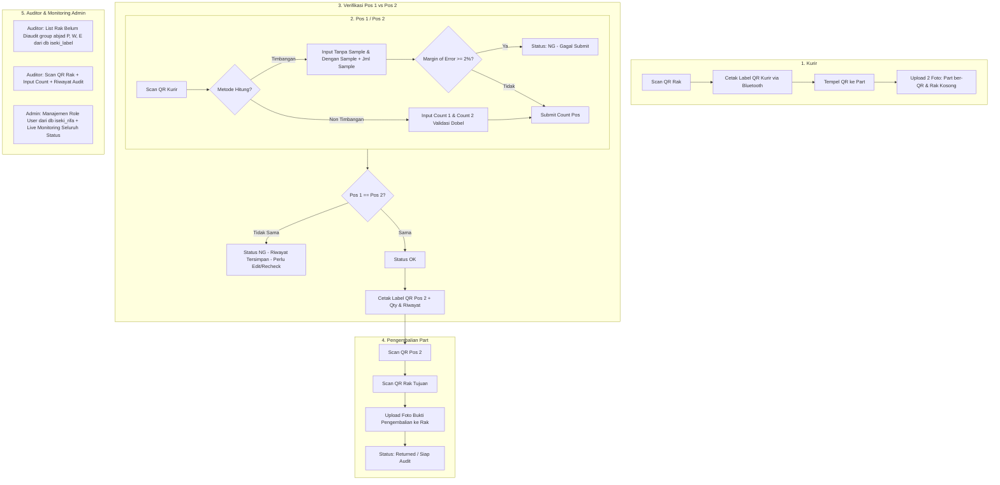

# Implementation Plan: Perombakan Total Alur Sistem Iseki Stockopname

Dokumen ini berisi rencana implementasi arsitektur baru untuk sistem **iseki_stockopname**, mencakup peran operasional baru (Kurir, Pos 1 & Pos 2 Timbangan/Non-Timbangan, Pengembalian, Auditor, Admin), integrasi thermal printer via Web Bluetooth API, sinkronisasi multi-database (`iseki_stockopname`, `iseki_rifa`, `iseki_label`), serta sistem audit dan tracking real-time.

---

## 1. Diagram Alur Sistem (Flowchart)



---

## 2. Definisi Role & Jobdesk

| Role / Jabatan | Sumber Akun | Jobdesk Utama | Output / Dokumen |
|---|---|---|---|
| **Kurir** | `Member` (Role: Kurir) | Scan QR Rak, Cetak QR Part, Upload Foto Part & Foto Rak Kosong | Label Kurir (Nama part, kode part, kode rak, no rak) + 2 Foto |
| **Pos 1 (Timbangan / Non-Timbangan)** | `Member` (Role: Pos 1) | Scan QR Part Kurir, Upload foto part (bebas jumlah), Input hitung (2x input atau input timbangan + sample dgn validasi toleransi < 2%) | Record Pos 1 (Count, Foto, Log Perhitungan) |
| **Pos 2 (Timbangan / Non-Timbangan)** | `Member` (Role: Pos 2) | Sama seperti Pos 1. Jika Pos 1 & 2 cocok $\rightarrow$ Cetak QR Pos 2 (tercantum Qty OK & log NG/OK) | Label Final Pos 2 + Verifikasi Status (OK / NG) |
| **Pengembalian** | `Member` (Role: Pengembalian) | Scan QR Pos 2, Scan QR Rak, Upload foto part sudah di rak | Status Part: Returned |
| **Auditor** | `Auditor` | Melihat list rak belum diaudit (kelompok abjad P, W, E dll), Scan QR rak, Input qty, Warning jika rak sudah diaudit | Audit Record & Audit Status |
| **Admin** | `Admin` | Konfigurasi role member (Kurir, Pos 1-2 Timbangan/Non, Pengembalian), Monitoring progres real-time | Full Tracking Dashboard |

---

## 3. Skema Basis Data (Database Schema)

### A. Tabel `member_roles` (Pengaturan Role Member dari `iseki_rifa`)
```sql
CREATE TABLE `member_roles` (
    `id` BIGINT UNSIGNED AUTO_INCREMENT PRIMARY KEY,
    `nik` VARCHAR(50) NOT NULL UNIQUE,
    `role` ENUM('courier', 'pos1_scale', 'pos1_manual', 'pos2_scale', 'pos2_manual', 'returner') NOT NULL,
    `created_at` TIMESTAMP NULL,
    `updated_at` TIMESTAMP NULL
);
```

### B. Tabel `so_items` (Tracking Utama Part / Siklus SO)
```sql
CREATE TABLE `so_items` (
    `id` BIGINT UNSIGNED AUTO_INCREMENT PRIMARY KEY,
    `tracking_code` VARCHAR(50) NOT NULL UNIQUE,
    `rack_no` VARCHAR(100) NOT NULL,
    `code_rack` VARCHAR(100) NULL,
    `code_part` VARCHAR(100) NOT NULL,
    `name_part` VARCHAR(255) NOT NULL,
    
    -- Data Kurir
    `courier_nik` VARCHAR(50) NULL,
    `courier_photo_part` VARCHAR(255) NULL,
    `courier_photo_rack` VARCHAR(255) NULL,
    `courier_printed_at` TIMESTAMP NULL,
    `courier_submitted_at` TIMESTAMP NULL,

    -- Data Pos 1 & Pos 2 Summary
    `pos1_status` ENUM('PENDING', 'OK', 'NG') DEFAULT 'PENDING',
    `pos1_final_count` INT NULL,
    `pos2_status` ENUM('PENDING', 'OK', 'NG') DEFAULT 'PENDING',
    `pos2_final_count` INT NULL,
    
    -- Status Final Verifikasi
    `verification_status` ENUM('PENDING', 'MATCH_OK', 'MISMATCH_NG') DEFAULT 'PENDING',
    `final_count` INT NULL,
    `pos2_printed_at` TIMESTAMP NULL,

    -- Data Pengembalian
    `return_nik` VARCHAR(50) NULL,
    `return_rack_scanned` VARCHAR(100) NULL,
    `return_photo` VARCHAR(255) NULL,
    `returned_at` TIMESTAMP NULL,

    -- Status Siklus SO
    `status` ENUM('IN_COURIER', 'IN_POS1', 'IN_POS2', 'MISMATCH_NG', 'WAITING_RETURN', 'RETURNED', 'COMPLETED') DEFAULT 'IN_COURIER',
    `created_at` TIMESTAMP NULL,
    `updated_at` TIMESTAMP NULL
);
```

### C. Tabel `so_count_histories` (Riwayat Perhitungan Pos 1 & Pos 2)
```sql
CREATE TABLE `so_count_histories` (
    `id` BIGINT UNSIGNED AUTO_INCREMENT PRIMARY KEY,
    `so_item_id` BIGINT UNSIGNED NOT NULL,
    `pos_type` ENUM('POS1', 'POS2') NOT NULL,
    `method` ENUM('MANUAL', 'SCALE') NOT NULL,
    `member_nik` VARCHAR(50) NOT NULL,
    
    -- Non-Timbangan (Manual)
    `input_count_1` INT NULL,
    `input_count_2` INT NULL,
    
    -- Timbangan (Scale)
    `scale_without_sample` DECIMAL(12, 4) NULL,
    `scale_with_sample` DECIMAL(12, 4) NULL,
    `sample_qty` INT NULL,
    `error_margin_percent` DECIMAL(5, 2) NULL,
    
    `calculated_count` INT NOT NULL,
    `status` ENUM('OK', 'NG') NOT NULL,
    `is_active` TINYINT(1) DEFAULT 1,
    `notes` TEXT NULL,
    `created_at` TIMESTAMP NULL,
    `updated_at` TIMESTAMP NULL,
    FOREIGN KEY (`so_item_id`) REFERENCES `so_items`(`id`) ON DELETE CASCADE
);
```

### D. Tabel `so_photos` (Foto Pos 1 & Pos 2 - Bebas Jumlah)
```sql
CREATE TABLE `so_photos` (
    `id` BIGINT UNSIGNED AUTO_INCREMENT PRIMARY KEY,
    `so_item_id` BIGINT UNSIGNED NOT NULL,
    `history_id` BIGINT UNSIGNED NULL,
    `pos_type` ENUM('POS1', 'POS2') NOT NULL,
    `photo_path` VARCHAR(255) NOT NULL,
    `created_at` TIMESTAMP NULL,
    FOREIGN KEY (`so_item_id`) REFERENCES `so_items`(`id`) ON DELETE CASCADE
);
```

### E. Tabel `auditor_records` (Catatan Audit)
```sql
CREATE TABLE `auditor_records` (
    `id` BIGINT UNSIGNED AUTO_INCREMENT PRIMARY KEY,
    `rack_no` VARCHAR(100) NOT NULL,
    `code_part` VARCHAR(100) NULL,
    `auditor_name` VARCHAR(100) NOT NULL,
    `audited_count` INT NOT NULL,
    `notes` TEXT NULL,
    `created_at` TIMESTAMP NULL,
    `updated_at` TIMESTAMP NULL
);
```

---

## 4. Logika Bisnis & Validasi

### A. Validasi Pos Manual (Non-Timbangan)
- Input dobel wajib diisi: `input_count_1` dan `input_count_2`.
- Jika `input_count_1 !== input_count_2` $\rightarrow$ Submit ditolak dengan pesan eror: *"Hasil verifikasi dobel input tidak sama"*.

### B. Validasi Pos Timbangan (Scale)
- Input: `scale_without_sample` ($W_0$), `scale_with_sample` ($W_s$), dan `sample_qty` ($N_s$).
$$\text{Bobot Per Sample} = \frac{W_s - W_0}{N_s}$$
$$\text{Margin of Error} = \left| \frac{\text{Perhitungan Baru} - \text{Perhitungan Acuan}}{\text{Perhitungan Acuan}} \right| \times 100\%$$
- Jika $\text{Margin of Error} \ge 2\% \rightarrow$ Status otomatis **NG**, data tidak bisa submit ke tahap berikutnya dan riwayat tersimpan sebagai recheck failure.

### C. Validasi Pos 1 vs Pos 2
- Setelah Pos 2 submit hitungan:
  - Jika $\text{Pos 1 Count} == \text{Pos 2 Count} \rightarrow$ Status **MATCH_OK**. Tombol cetak QR label Pos 2 aktif.
  - Jika $\text{Pos 1 Count} \ne \text{Pos 2 Count} \rightarrow$ Status **MISMATCH_NG**.
  - Form edit perhitungan tersedia untuk koreksi, dengan seluruh riwayat sebelumnya tetap tersimpan di `so_count_histories` (tidak menimpa record lama).

### D. Web Bluetooth Printing (ESC/POS)
- Dijalankan via Android Chrome menggunakan `navigator.bluetooth.requestDevice({ filters: [{ services: ['000018f0-0000-1000-8000-00805f9b34fb'] }] })` atau serial/raw printer profile.
- Format cetak label mencakup:
  - **Label Kurir**: QR Code (berisi `tracking_code`), Nama Part, Kode Part, Kode Rak, Nomor Rak, Tanggal/Jam.
  - **Label Pos 2 (Final)**: QR Code (berisi `tracking_code` + Status OK + Jumlah), Qty Final, Riwayat log verifikasi (OK/NG count), Timestamp.

### E. Modul Auditor & Integrasi `iseki_label`
- Query daftar rak master dari database `iseki_label.rack_part_lists`:
  - Mengambil daftar unik `rack_no`.
  - Mengelompokkan berdasarkan huruf abjad awal (`LEFT(rack_no, 1)` misal **P**, **W**, **E**, dll).
  - Menandai rak yang sudah diaudit dan rak yang **belum diaudit**.
  - Saat auditor memindai rak yang sudah diaudit sebelumnya, sistem memunculkan popup konfirmasi:
    > *"Peringatan: Rak [rack_no] sudah diaudit sebelumnya pada [Waktu] oleh [Auditor] dengan hasil [Qty]. Apakah Anda ingin melakukan audit ulang?"*

---

## 5. Rencana Tahapan Eksekusi (Milestones)

1. **Fase 1: Database & Migrasi**
   - Buat migration untuk `member_roles`, `so_items`, `so_count_histories`, `so_photos`, dan `auditor_records`.
   - Setup konfigurasi database `rifa` dan `label` di `config/database.php`.

2. **Fase 2: Admin - Role Management & Live Monitoring**
   - Menu alokasi member dari tabel `iseki_rifa.employees` ke role (Kurir, Pos 1/2 Timbangan/Manual, Pengembalian).
   - Dashboard monitoring status real-time siklus stockopname.

3. **Fase 3: Modul Kurir**
   - UI Android friendly: Scan QR rak, preview data part dari master rak, cetak thermal bluetooth ESC/POS.
   - Ambil 2 foto wajib (part ber-QR + rak kosong) dan submit status ke `so_items`.

4. **Fase 4: Modul Pos 1 & Pos 2**
   - Scan QR tracking dari kurir.
   - Form hitung manual (validasi dobel 2x input).
   - Form hitung timbangan (kalkulasi margin of error < 2%).
   - Upload multiple foto bukti fisik.
   - Verifikasi Pos 1 vs Pos 2, status OK / NG, edit perhitungan ber-histori, dan cetak QR Pos 2.

5. **Fase 5: Modul Pengembalian**
   - Scan QR Pos 2 & Scan QR fisik rak tujuan.
   - Ambil foto bukti part telah kembali ke rak.

6. **Fase 6: Modul Auditor**
   - List rak belum diaudit (dikelompokkan abjad P, W, E dari `iseki_label`).
   - Fitur scan & audit rak dengan notifikasi audit ganda/riwayat sebelumnya.

