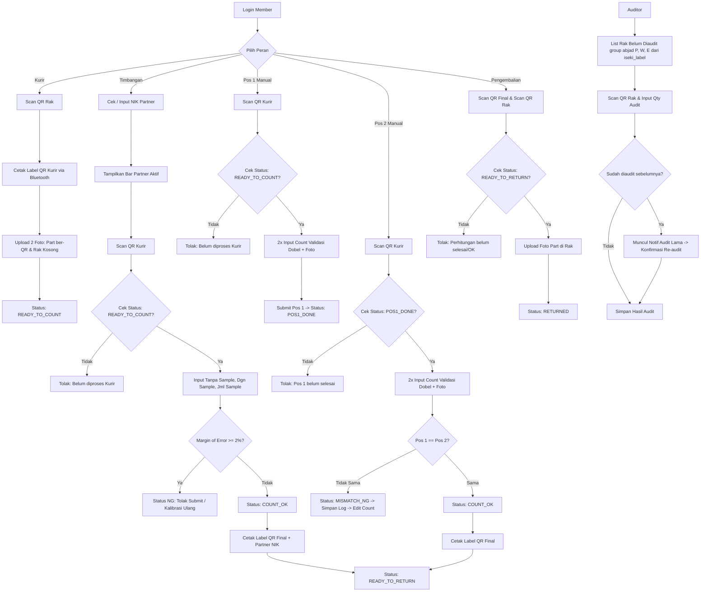

# Implementation Plan: Perombakan Total Alur Sistem Iseki Stockopname

Dokumen ini berisi rencana arsitektur dan implementasi teknis sistem **iseki_stockopname**. Rencana ini dirancang modular agar dapat dieksekusi secara **paralel oleh 2 developer (Developer A & Developer B)** tanpa bentrok kode (*code conflict*).

---

## 1. Ringkasan Perubahan Alur & Aturan Bisnis Baru

1. **Pemilihan Peran Mandiri & Fleksibel (Self-Serve Role Switch)**:
   - Akun `member` saat login tidak dipatok role statis oleh admin.
   - Member dapat memilih peran: **Kurir**, **Pos 1 (Manual)**, **Pos 2 (Manual)**, **Timbangan**, atau **Pengembalian**.
   - Member dapat berganti peran kapan saja melalui menu/switcher peran di header.
2. **Pos Timbangan Tunggal & Master Data Timbangan**:
   - Proses timbangan tidak memerlukan pos 1 dan pos 2 terpisah, melainkan dikerjakan oleh **2 orang partner sekaligus**.
   - **Master Timbangan (CRUD Admin)**: Admin memiliki menu CRUD data timbangan (tabel `scales`), menyimpan kode/nomor timbangan berupa `VARCHAR` (contoh: `TB-01`, `SCALE-A`, dsb.) beserta deskripsi/kapasitas.
   - **Pemilihan Timbangan via Dropdown**: Di sisi member timbangan, selain NIK Partner, member memilih nomor timbangan yang sedang digunakan melalui dropdown select.
   - Saat pertama kali masuk menu Timbangan, sistem mewajibkan input **NIK Partner** (divalidasi ke `iseki_rifa.employees`) dan memilih **Nomor Timbangan**.
   - Informasi partner aktif dan nomor timbangan aktif ditampilkan di bar atas antarmuka Timbangan, dengan tombol untuk ganti partner/timbangan sewaktu-waktu.
   - Perhitungan timbangan: input bobot tanpa sample, bobot dengan sample, dan jumlah sample. Margin of error wajib $< 2\%$. Jika $\ge 2\% \rightarrow$ NG, tidak bisa submit.
   - Setelah sukses OK di timbangan $\rightarrow$ langsung cetak label QR Final dan lanjut ke alur **Pengembalian**.
3. **Penanganan Data Rak & Master `iseki_label`**:
   - Kurir memindai QR fisik rak (menghasilkan nilai `rack_no` / `rack`).
   - **Validasi Data Rak Kosong / Belum Didaftarkan**: Jika data rak pada tabel `iseki_label.rack_part_lists` (kolom `rack`) bernilai `NULL`, kosong `''`, atau belum terdaftar $\rightarrow$ Muncul notifikasi: *"Rak belum didaftarkan di master label, silakan hubungi admin/tunggu hingga terisi. Tidak bisa cetak QR."*
   - **Penanganan Rak Ganda (Multiple Areas / Cells)**: Jika satu nomor rak (`rack`) memiliki beberapa area/part yang berbeda, kurir diberikan opsi memilih area/part mana yang sedang diambil.
   - **Proses Independen Part Sama di Rak Berbeda**: Jika terdapat part yang sama berada di rak berbeda (misal part A di Rak E1 dan part A di Rak W3), masing-masing diproses secara independen dan paralel dengan `tracking_code` terpisah tanpa harus menunggu proses rak lainnya selesai.
4. **Alur Wajib Berurutan (Strict Step Sequence)**:
   - Part/Kode Rak tidak boleh melompati tahapan:
     $$\text{Kurir} \longrightarrow \left[ \begin{array}{l} \text{Timbangan (Partner)} \\ \text{ATAU} \\ \text{Pos 1 (Manual)} \longrightarrow \text{Pos 2 (Manual)} \end{array} \right] \longrightarrow \text{Pengembalian} \longrightarrow \text{Auditor}$$
   - Sistem memvalidasi status tahapan sebelumnya sebelum membuka form pengerjaan. Jika status belum memenuhi syarat, muncul pesan penolakan yang jelas.
5. **Alur Non-Timbangan (Pos 1 $\rightarrow$ Pos 2)**:
   - Pos 1: input hitung dengan validasi 2x input (jika input 1 $\ne$ input 2 $\rightarrow$ gagal submit) + upload foto part.
   - Pos 2: scan QR kurir, input validasi 2x input + upload foto part.
   - Jika $\text{Pos 1} == \text{Pos 2} \rightarrow$ **OK** $\rightarrow$ Cetak label QR Final.
   - Jika $\text{Pos 1} \ne \text{Pos 2} \rightarrow$ **NG** $\rightarrow$ Muncul status mismatch, form edit terbuka untuk revisi, dan riwayat lama tersimpan lengkap di database.
6. **Pengembalian**:
   - Memindai QR label Pos 2 / Timbangan dan QR fisik rak tujuan, lalu mengambil foto bukti part sudah kembali di rak.
7. **Auditor**:
   - Menampilkan list rak belum diaudit yang dikelompokkan berdasarkan huruf depan rak (**P**, **W**, **E**, dll.) dari database `iseki_label.rack_part_lists`.
   - Scan QR rak & input qty hasil audit. Jika rak sudah pernah diaudit, muncul peringatan riwayat audit sebelumnya dengan opsi audit ulang.
8. **Penyimpanan Fitur Lama (AI / SAM & OCR / OpenCV / Tesseract)**:
   - Fitur perhitungan lama yang menggunakan AI (Segment Anything Model / SAM via ONNX `ort.min.js`, `sam-counter.js`, `sam-worker.js`) dan OCR (OpenCV.js, Tesseract.js) **TIDAK DIHAPUS**.
   - Seluruh kode, aset JS/WASM di `public/assets/js/plugin/ort/`, `opencv.js`, `tesseract.min.js`, dan blade template terkait (`record_create.blade.php`, `dual_check_create.blade.php`) tetap dipertahankan dan diarsipkan ke file terpisah (misal namespace/folder arsip `legacy/`).
   - Fitur-fitur lama ini **dikeluarkan dari menu aktif / navigasi UI utama** agar alur baru tetap bersih dan fokus pada operasional timbangan manual & timbangan partner.

---

## 2. Diagram Alur Kerja (Workflow)



---

## 3. Skema Basis Data

```
iseki_stockopname
├── scales (Master data timbangan nomor/kode timbangan)
├── so_items (Data induk tracking part & status siklus)
├── so_count_histories (Riwayat hitung manual pos 1, pos 2, & timbangan)
├── so_photos (Galeri foto pengerjaan)
├── member_sessions (Status peran aktif, NIK partner, & timbangan sesi member)
└── auditor_records (Catatan hasil audit fisik rak)
```

### A. Tabel `scales` (Master Timbangan - CRUD Admin)
```sql
CREATE TABLE `scales` (
    `id` BIGINT UNSIGNED AUTO_INCREMENT PRIMARY KEY,
    `scale_number` VARCHAR(50) NOT NULL UNIQUE,
    `scale_name` VARCHAR(100) NULL,
    `location` VARCHAR(100) NULL,
    `is_active` TINYINT(1) DEFAULT 1,
    `created_at` TIMESTAMP NULL,
    `updated_at` TIMESTAMP NULL
);
```

### B. Tabel `member_sessions`
Menyimpan state role yang sedang dipilih, partner aktif, dan nomor timbangan aktif member.
```sql
CREATE TABLE `member_sessions` (
    `id` BIGINT UNSIGNED AUTO_INCREMENT PRIMARY KEY,
    `nik` VARCHAR(50) NOT NULL UNIQUE,
    `active_role` ENUM('courier', 'scale', 'pos1', 'pos2', 'returner') NOT NULL DEFAULT 'courier',
    `scale_partner_nik` VARCHAR(50) NULL,
    `scale_id` BIGINT UNSIGNED NULL,
    `updated_at` TIMESTAMP NULL,
    FOREIGN KEY (`scale_id`) REFERENCES `scales`(`id`) ON DELETE SET NULL
);
```

### C. Tabel `so_items`
```sql
CREATE TABLE `so_items` (
    `id` BIGINT UNSIGNED AUTO_INCREMENT PRIMARY KEY,
    `tracking_code` VARCHAR(50) NOT NULL UNIQUE,
    `rack_label_id` BIGINT UNSIGNED NULL,
    `rack_no` VARCHAR(100) NOT NULL,
    `code_rack` VARCHAR(100) NULL,
    `area` VARCHAR(100) NULL,
    `cell` VARCHAR(100) NULL,
    `code_part` VARCHAR(100) NOT NULL,
    `name_part` VARCHAR(255) NOT NULL,
    `process_type` ENUM('MANUAL', 'SCALE') NULL,
    
    -- Status Siklus Terkini
    `current_step` ENUM('COURIER', 'READY_TO_COUNT', 'POS1_DONE', 'MISMATCH_NG', 'READY_TO_RETURN', 'RETURNED') NOT NULL DEFAULT 'COURIER',
    
    -- Kurir
    `courier_nik` VARCHAR(50) NULL,
    `courier_photo_part` VARCHAR(255) NULL,
    `courier_photo_rack` VARCHAR(255) NULL,
    `courier_at` TIMESTAMP NULL,

    -- Hasil Perhitungan
    `final_count` INT NULL,
    `pos1_count` INT NULL,
    `pos2_count` INT NULL,
    `scale_id` BIGINT UNSIGNED NULL,
    `scale_number` VARCHAR(50) NULL,
    `scale_user_nik` VARCHAR(50) NULL,
    `scale_partner_nik` VARCHAR(50) NULL,
    `count_completed_at` TIMESTAMP NULL,

    -- Pengembalian
    `return_nik` VARCHAR(50) NULL,
    `return_rack_scanned` VARCHAR(100) NULL,
    `return_photo` VARCHAR(255) NULL,
    `returned_at` TIMESTAMP NULL,

    `created_at` TIMESTAMP NULL,
    `updated_at` TIMESTAMP NULL,
    FOREIGN KEY (`scale_id`) REFERENCES `scales`(`id`) ON DELETE SET NULL
);
```

### C. Tabel `so_count_histories`
```sql
CREATE TABLE `so_count_histories` (
    `id` BIGINT UNSIGNED AUTO_INCREMENT PRIMARY KEY,
    `so_item_id` BIGINT UNSIGNED NOT NULL,
    `count_type` ENUM('SCALE', 'POS1', 'POS2') NOT NULL,
    `member_nik` VARCHAR(50) NOT NULL,
    `partner_nik` VARCHAR(50) NULL,
    
    -- Non-Timbangan
    `input_1` INT NULL,
    `input_2` INT NULL,
    
    -- Timbangan
    `weight_no_sample` DECIMAL(12, 4) NULL,
    `weight_with_sample` DECIMAL(12, 4) NULL,
    `sample_qty` INT NULL,
    `error_margin_percent` DECIMAL(5, 2) NULL,
    
    `result_count` INT NOT NULL,
    `status` ENUM('OK', 'NG') NOT NULL,
    `notes` TEXT NULL,
    `created_at` TIMESTAMP NULL,
    FOREIGN KEY (`so_item_id`) REFERENCES `so_items`(`id`) ON DELETE CASCADE
);
```

### D. Tabel `auditor_records`
```sql
CREATE TABLE `auditor_records` (
    `id` BIGINT UNSIGNED AUTO_INCREMENT PRIMARY KEY,
    `rack_no` VARCHAR(100) NOT NULL,
    `code_part` VARCHAR(100) NULL,
    `auditor_name` VARCHAR(100) NOT NULL,
    `audited_count` INT NOT NULL,
    `notes` TEXT NULL,
    `created_at` TIMESTAMP NULL,
    `updated_at` TIMESTAMP NULL
);
```

---

## 4. Pembagian Kerja Paralel 2 Developer (Zero Conflict Strategy)

Agar 2 developer dapat mengerjakan proyek secara bersamaan tanpa merge conflict pada file yang sama:
- **Shared Foundation (Fase 1)** diselesaikan lebih dulu (Database Migration & Session Role Manager).
- File Controller dan View dibagi **secara independen per folder**:
  - **Developer A** bertanggung jawab pada area **Fisik & Pergerakan Barang**: Kurir, Pengembalian, Web Bluetooth Print Helper, serta Modul Auditor.
  - **Developer B** bertanggung jawab pada area **Perhitungan & Validasi**: Modul Timbangan (dengan Partner logic), Modul Pos 1 & Pos 2 Manual (dengan Validasi Dobel & Log NG), serta Monitoring Admin.

| Komponen | Developer A | Developer B |
|---|---|---|
| **Alur Operasional** | Kurir & Pengembalian | Timbangan & Pos 1/Pos 2 Manual |
| **Integrasi Eksternal** | Web Bluetooth Print ESC/POS & DB `iseki_label` | Validasi NIK Partner di DB `iseki_rifa` |
| **Controller** | `CourierController.php`<br>`ReturnController.php`<br>`AuditorModuleController.php` | `ScaleController.php`<br>`ManualCountController.php`<br>`AdminMonitoringController.php` |
| **View Directory** | `resources/views/courier/`*<br>`resources/views/return/`*<br>`resources/views/auditor/`* | `resources/views/scale/`*<br>`resources/views/manual/`*<br>`resources/views/admin/monitoring/`* |
| **JavaScript Helper** | `public/assets/js/bt-thermal-printer.js` (Helper Bluetooth global) | `public/assets/js/scale-calc.js` (Kalkulator timbangan & margin) |

---

## 5. Rencana Fase Eksekusi

```
┌────────────────────────────────────────────────────────┐
│ Fase 1: Setup Foundation (Migration & Role Switcher)   │
└──────────────────────────┬─────────────────────────────┘
                           │
             ┌─────────────┴─────────────┐
             ▼                           ▼
┌───────────────────────────┐ ┌───────────────────────────┐
│ Fase 2A (Developer A)     │ │ Fase 2B (Developer B)     │
│ - Courier Module          │ │ - Scale Module + Partner  │
│ - Web Bluetooth Print JS  │ │ - Margin of Error (< 2%)  │
└────────────┬──────────────┘ └───────────┬───────────────┘
             │                            │
             ▼                            ▼
┌───────────────────────────┐ ┌───────────────────────────┐
│ Fase 3A (Developer A)     │ │ Fase 3B (Developer B)     │
│ - Return Module           │ │ - Manual Pos 1 & Pos 2    │
│ - Double Scan (Rak & QR)  │ │ - NG Log & Verification   │
└────────────┬──────────────┘ └───────────┬───────────────┘
             │                            │
             ▼                            ▼
┌───────────────────────────┐ ┌───────────────────────────┐
│ Fase 4A (Developer A)     │ │ Fase 4B (Developer B)     │
│ - Auditor Module          │ │ - Admin Live Monitoring   │
│ - Unaudited List (A-Z)    │ │   & Cycle Status Board    │
└────────────┬──────────────┘ └───────────┬───────────────┘
                           │
                           ▼
┌────────────────────────────────────────────────────────┐
│ Fase 5: Integration, End-to-End Test, & Deployment     │
└────────────────────────────────────────────────────────┘
```

### Fase 1: Setup Fondasi (Database & Role Switcher)
1. Buat file migration:
   - `2026_10_30_000002_create_scales_table.php` (Master Timbangan)
   - `2026_10_30_000003_create_member_sessions_table.php`
   - `2026_10_30_000004_create_so_items_table.php`
   - `2026_10_30_000005_create_so_count_histories_table.php`
   - `2026_10_30_000006_create_auditor_records_table.php`
2. Konfigurasi koneksi database `rifa` dan `label` di `config/database.php`.
3. Buat Middleware dan Controller untuk **Role Switcher**:
   - `RoleSelectionController.php`: Menangani halaman pemilihan peran setelah login dan endpoint ganti peran sewaktu-waktu.
   - Komponen Header: Menampilkan badge peran aktif + dropdown cepat switch peran.
4. **Isolasi Fitur Lama (AI & OCR)**:
   - File controller & view lama (`record_create.blade.php`, `dual_check_create.blade.php`, `DualCheckController.php`, `RecordController.php`) tetap dipertahankan.
   - Pustaka pendukung (`opencv.js`, `tesseract.min.js`, `ort/`, model ONNX SAM) **tidak dihapus**.
   - Hapus/sembunyikan rute menu lama dari navigation bar sidebar (`resources/views/layouts/main.blade.php`) sehingga pengguna hanya mengakses alur baru yang terstruktur. Jika suatu saat ingin dibuka kembali, rutenya tetap utuh di controller.

### Fase 2: Pengerjaan Paralel (Sprint 1)
- **Developer A — Modul Kurir, Integrasi Rak Label & Bluetooth Printer**:
  - Integrasi query rak ke database `iseki_label.rack_part_lists`:
    - Validasi rak: jika kolom `rack` kosong/NULL/belum didaftarkan $\rightarrow$ muncul notifikasi peringatan dan cegah cetak QR.
    - Penanganan rak ganda: jika satu nomor rak memiliki beberapa baris data/part/area $\rightarrow$ sediakan modal pemilihan area/part yang sedang diproses.
    - Part yang sama pada rak berbeda diproses terpisah secara independen dan paralel (masing-masing punya `tracking_code` unik).
  - Buat library JS modular `public/assets/js/bt-thermal-printer.js` (Web Bluetooth API ESC/POS 58mm/80mm).
  - Tampilan Android-friendly scan QR rak (menggunakan kamera HTML5 QR Scanner).
  - Cetak label Kurir via Bluetooth (Nama part, kode part, kode rak, no rak).
  - Form capture 2 foto (foto part ber-QR dan foto rak kosong).
  - Update status record ke `READY_TO_COUNT`.
- **Developer B — Modul CRUD Master Timbangan (Admin) & Modul Timbangan (Member)**:
  - CRUD Admin untuk master timbangan (`ScaleController.php`): kelola nomor timbangan (varchar, cth: `TB-01`), nama/merek, lokasi.
  - Modal / Banner penentuan NIK Partner & Dropdown pilih nomor timbangan di awal masuk halaman timbangan.
  - Validasi NIK Partner ke database `iseki_rifa.employees`.
  - Header persistent menampilkan nama/NIK partner dan nomor timbangan aktif, lengkap dengan tombol *Ganti Partner / Ganti Timbangan*.
  - Validasi urutan: wajib berstatus `READY_TO_COUNT`.
  - Form input: Berat tanpa sample, Berat dengan sample, dan Jumlah sample.
  - Logika margin of error: jika $\ge 2\% \rightarrow$ status **NG**, submit ditolak dan riwayat tersimpan.
  - Jika OK $\rightarrow$ update status ke `READY_TO_RETURN`, simpan `scale_id` & partner NIK, dan cetak label QR final via helper Bluetooth.

### Fase 3: Pengerjaan Paralel (Sprint 2)
- **Developer A — Modul Pengembalian (Return)**:
  - Validasi urutan: wajib berstatus `READY_TO_RETURN`.
  - Fitur scan ganda: Scan QR label final $\rightarrow$ kemudian scan QR fisik rak.
  - Verifikasi kesesuaian rak asal dengan rak tujuan.
  - Upload foto bukti penataan part kembali di rak.
  - Update status siklus ke `RETURNED`.
- **Developer B — Modul Non-Timbangan (Pos 1 & Pos 2 Manual)**:
  - Pos 1: Validasi status `READY_TO_COUNT`. Form input ganda (Input 1 & Input 2 wajib sama) + upload foto. Simpan ke `so_count_histories` dan set status ke `POS1_DONE`.
  - Pos 2: Validasi status `POS1_DONE`. Form input ganda + upload foto.
  - Logika verifikasi Pos 1 vs Pos 2:
    - Jika cocok $\rightarrow$ Status `READY_TO_RETURN`, simpan hitungan final, aktifkan cetak label QR final.
    - Jika mismatch $\rightarrow$ Status `MISMATCH_NG`. Sediakan antarmuka koreksi/recheck hitung tanpa menghapus histori sebelumnya.

### Fase 4: Pengerjaan Paralel (Sprint 3)
- **Developer A — Modul Auditor**:
  - Integrasi query ke `iseki_label.rack_part_lists`.
  - Tampilan daftar rak belum diaudit yang dikelompokkan berdasarkan huruf awalan (**P**, **W**, **E**, dll.).
  - Fitur scan QR rak & input qty hasil audit.
  - Pengecekan audit berulang: jika rak sudah ada di `auditor_records`, tampilkan riwayat sebelumnya dan konfirmasi re-audit.
- **Developer B — Modul Monitoring Admin**:
  - Dashboard monitoring real-time siklus stockopname:
    - Ringkasan status: Total Kurir $\rightarrow$ Dalam Hitung $\rightarrow$ Mismatch NG $\rightarrow$ Menunggu Pengembalian $\rightarrow$ Selesai.
    - Filter berdasarkan nomor rak, kurir, dan tanggal/waktu.
    - Matriks audit status rak.

### Fase 5: Integrasi & Uji Coba Lapangan
1. Menggabungkan route ke `routes/web.php` dalam grup middleware masing-masing.
2. Uji alur berurutan (*sequential integrity check*): memastikan tidak ada item yang bisa meloncat tahapan.
3. Uji cetak Bluetooth langsung dari Chrome Android pada device thermal printer.
4. Uji pergantian partner timbangan dan pergantian peran mandiri pengguna.
